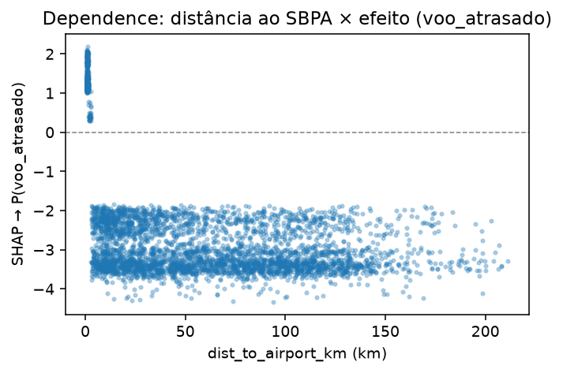
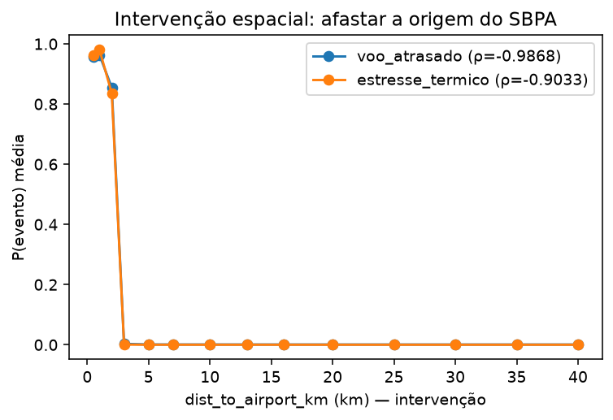

# Previsão de Demanda de Corridas por Aplicativo a partir de Dados Contribuídos pelo Motorista:
# uma Proposta de Ciência de Dados para a Autonomia Informacional do Trabalhador

> **Rascunho para submissão ao SBBD/CSBC — versão 0.5 (11/10/2026)**
> Autores: Fabricio Barili, [Orientador]
> Filiação: [Universidade]
> Implementação documentada em `Work/`; moldura e estilo em `.claude/skills/escrita-artigo/`.

---

## Resumo

_(a redigir ao final, espelhando o Abstract — quatro movimentos: problema → lacuna →
proposta → achado. Ver `references/estrutura-artigo.md`.)_

## Abstract

_(to be written last, mirroring the Resumo.)_

**Palavras-chave:** ciência de dados, previsão de demanda, ride-hailing, dados contribuídos,
worker data science, autonomia informacional, LightGBM, SHAP, indexação H3.

---

## 1. Introdução

No trabalho mediado por plataformas de *ride-hailing*, a desigualdade entre empresa e
motorista raramente se esgota no plano econômico: ela é, antes de tudo, uma **assimetria de
conhecimento**. A plataforma opera sobre o agregado — sabe quantos carros circulam, estima a
elasticidade de cada bairro, antecipa picos e ajusta preços em tempo real —, enquanto o
motorista decide a partir de fragmentos: o mapa que vê naquele instante, a memória das
corridas de ontem e os sinais que o próprio sistema resolve emitir. Van Dijck, Poell e De Waal
(2018) descrevem essa arquitetura como uma infraestrutura em que dados e algoritmos organizam
relações sociais e distribuem possibilidades de ação; Abílio (2020) a condensa na figura do
trabalhador *just-in-time*, formalmente autônomo e materialmente dependente de decisões que
não controla. A tese que motiva este estudo resume o descompasso em uma imagem: a plataforma
calcula a cidade, e o motorista persegue sinais da cidade calculada [BARILI_TESE]. A diferença
de escala observacional é, no limite, uma diferença de poder [MCDAID_2023; MURAKAMI_WOOD_2019].

Essa assimetria não é um acidente operacional; é sustentada pela opacidade do sistema.
Grohmann et al. (2021) cunham o conceito de *platform scam* para nomear não as fraudes
pontuais, mas as formas estruturais de incerteza embutidas no gerenciamento algorítmico — o
motorista não acessa os critérios de precificação, desconhece a lógica que distribui as
chamadas e não tem como verificar se a promessa de ganho se cumpriu com justiça. Phatak (2022)
agrega um complicador técnico: a arquitetura de microsserviços da plataforma recompõe-se de
forma contínua, em ritmo que supera a capacidade de observação empírica de quem está ao
volante. A caixa-preta, portanto, não é uma falha a corrigir — é uma propriedade do projeto.

Diante desse quadro, a Ciência de Dados oferece uma resposta, sob uma condição: só é útil ao
trabalhador aquilo que produz **informação interpretável**, e não mais uma caixa-preta a
competir com a da plataforma. Em vez de tentar reconstruir o algoritmo proprietário, propomos
erguer uma **inteligência externa** sobre sinais que o próprio motorista observa e registra. A
virada está na origem do dado: não um registro corporativo inacessível, tampouco uma simulação,
mas a telemetria **contribuída pelos próprios motoristas**. Cada evento reúne quatro campos —
latitude, longitude, instante e um valor booleano que indica se há passageiro a bordo —, e é
justamente a transição desse booleano, de livre para ocupado e de volta, que converte uma
trajetória de pontos no mapa em corrida identificável. A dimensão geoespacial é tratada pelo
sistema de indexação hierárquica H3 [UBER_H3], que representa posições, zonas e distâncias em
células hexagonais compatíveis com múltiplas fontes de dados urbanos. Materializa-se, aqui, a
agenda de *worker data science* que Woodcock e Ruiner (2026) delineiam: dados e modelos deixam
de ser monopólio gerencial e passam a recurso de quem trabalha. É preciso, contudo, demarcar o
estatuto da proposta. A previsão de demanda não é oferecida como solução para a assimetria, mas
como prova de conceito de um caminho de **autonomia informacional do trabalhador**.

Resta uma barreira concreta, e ela é de dados. Operadoras como Uber e 99 não divulgam registros
desagregados de corridas por origem e destino [UBER_MOVEMENT], e acordos com o poder público,
quando existem, alcançam poucas cidades; o Aeroporto Internacional Salgado Filho (SBPA), em
Porto Alegre — recorte inicial deste trabalho e polo de demanda concentrada —, não escapa à
regra. A coleta contribuída ataca o problema na origem, ao produzir o dado exatamente onde ele
falta. Enquanto
esse volume ainda cresce, a síntese condicionada a fontes abertas — chegadas de voos e
meteorologia histórica — cumpre a função de partida a frio: um ambiente controlado para depurar
a esteira e, principalmente, para verificar se o modelo recupera relações causais já conhecidas
[HOLZINGER_2023; KOBAYASHI_2024]. É esta a hipótese que o trabalho se propõe a validar —
elementos observáveis, registrados pelo próprio motorista, bastam para compor um algoritmo
preditivo e explicável capaz de sustentar, no plano técnico, uma proposta de autonomia
informacional.

Deste movimento decorrem três **contribuições**:

1. uma **proposta de pipeline de Ciência de Dados**, versionada e auditável de ponta a ponta
   com DVC [KUPRIEIEV_2021], que converte telemetria contribuída por motoristas — da coleta e
   normalização à indexação geoespacial H3 [UBER_H3] e à engenharia de *features* — em previsão
   de corridas;
2. um **modelo explicável** (LightGBM [KE_2017] com valores SHAP [LUNDBERG_2017]) que não se
   limita a prever, mas devolve ao motorista os fatores observáveis que governam a demanda;
3. um **protocolo de validação causal** apoiado em síntese condicionada, que verifica se o
   modelo recupera as relações injetadas no processo gerador e, assim, demonstra a viabilidade
   técnica da proposta;
4. uma **camada de predição conversacional** que fecha o laço de ponta a ponta — o motorista
   interroga o que foi aprendido sobre um horário futuro e recebe, ancorada em SHAP e em
   linguagem natural, uma recomendação interpretável de ir ou não ao polo de demanda.

O restante do artigo organiza-se como segue. A Seção 2 situa o trabalho na literatura; a Seção
3 detalha a metodologia, estágio a estágio, da coleta à conversa com o motorista; a Seção 4 descreve a
configuração experimental; a Seção 5 discute os resultados e o que deles o motorista pode
extrair; e a Seção 6 conclui.

---

## 2. Trabalhos Relacionados

### 2.1 Previsão de demanda em mobilidade urbana

Prever onde e quando a demanda por transporte se forma é um problema antigo da Ciência de
Dados aplicada à mobilidade, e sua trajetória metodológica acompanha a da própria disciplina:
dos modelos clássicos de séries temporais às abordagens de aprendizado de máquina [YAO_2018]
e, mais recentemente, às redes neurais profundas — LSTMs e arquiteturas atencionais
[DIDI_2018] — que dominam a literatura sempre que há dados proprietários em larga escala.
Modelos de *gradient boosting*, como XGBoost [CHEN_2016] e LightGBM [KE_2017], ocupam um lugar
particular nesse espectro: entregam desempenho competitivo a um custo computacional muito
menor, sobretudo quando as *features* temporais e contextuais são bem construídas [ZHENG_2020].
No recorte aeroportuário, Flores e Rayle (2018) mostraram que atrasos elevados nas chegadas
elevam a demanda por táxi de maneira mensurável [FLORES_2018]; Tan et al. (2016) e Yang et al.
(2020) examinaram os efeitos de clima e de horário em Cingapura e Nova York. Para o Brasil, a
literatura sobre previsão de *rideshare* aeroportuário é escassa — lacuna que este trabalho
ajuda a ocupar.

### 2.2 Indexação geoespacial hierárquica

Representar o espaço urbano de forma computacionalmente tratável é condição para qualquer
modelo que combine origem, destino e contexto. O sistema H3 [UBER_H3] resolve o problema com
uma grade hexagonal hierárquica: cada célula tem vizinhança uniforme — ao contrário das grades
quadradas, em que vizinhos diagonais e ortogonais distam de forma desigual — e pode ser
refinada ou agregada entre resoluções sem perder o alinhamento. Essa propriedade importa aqui
por duas razões: permite indexar a malha viária, as zonas de demanda e as posições dos
motoristas num mesmo referencial, e torna barato calcular distâncias aproximadas por contagem
de saltos entre células.

### 2.3 Simulação baseada em agentes e dados sintéticos

Quando o dado real falta, duas tradições se oferecem. A primeira é a geração de dados
sintéticos como ambiente experimental legítimo, defensável desde que o processo gerador seja
explícito e auditável [HOLZINGER_2023; KOBAYASHI_2024]. A segunda é a simulação baseada em
agentes, que não produz amostras isoladas, mas deixa *emergir* padrões espaço-temporais do
comportamento de muitos indivíduos interagindo com o ambiente. Bonnetain et al. (2021) e Basu
et al. (2020) calibram simulações de mobilidade com parâmetros empíricos; Yuan et al. (2022)
exploram GANs para trajetórias urbanas realistas. A opção adotada aqui combina as duas vias —
motoristas-agentes circulam sobre a malha viária real, e a demanda que encontram é condicionada
a eventos observáveis externos. Preserva-se, assim, a auditabilidade do gerador e, ao mesmo
tempo, obtém-se a dinâmica emergente (concentração em torno de eventos, ritmo de turno, retorno
para casa) que um gerador corrida-a-corrida não captura.

### 2.4 Dados contribuídos e *worker data science*

Há uma diferença de princípio entre extrair dados do trabalhador e os dados serem *contribuídos*
por ele. Van Dijck, Poell e De Waal (2018) descrevem a plataforma como infraestrutura que
captura e organiza esses dados em favor de quem a controla; Grohmann et al. (2021) mostram o
custo dessa captura para quem trabalha. Woodcock e Ruiner (2026) propõem a inversão: dados e
modelos como recurso do próprio trabalhador — uma *worker data science*. É nessa tradição que
este trabalho se inscreve, e dela deriva a escolha do dado-fonte: não o registro corporativo,
mas a telemetria que o motorista produz e, em princípio, controla.

### 2.5 IA explicável em sistemas de trabalho por plataforma

Valores SHAP [LUNDBERG_2017; LUNDBERG_2020] consolidaram-se como padrão para explicar modelos
baseados em árvores, e já foram aplicados à mobilidade — Li et al. (2021) e Zhang et al. (2022)
os usaram para interpretar demanda de ônibus e risco de acidentes. A contribuição deste trabalho
não está na técnica, mas no seu endereçamento: a explicação não serve para auditar um modelo
corporativo, mas para devolver ao motorista os fatores observáveis que governam a demanda.
Barredo Arrieta et al. (2020) sustentam teoricamente essa escolha ao argumentar que a
explicabilidade deve ser medida pela adequação ao público e à decisão que apoia — e a decisão,
aqui, é a de quem precisa saber por que vale a pena estar em certo lugar a certa hora.

## 3. Metodologia

A proposta materializa-se em uma esteira de Ciência de Dados que vai do sinal observável ao
dado contribuído pelo motorista. A Figura 1 apresenta sua arquitetura. O que a distingue de um
gerador de demanda convencional é a combinação de dois compromissos: a demanda é condicionada a
**eventos públicos verificáveis** — voos atrasados e estresse térmico — e o dado é produzido por
**motoristas-agentes** que circulam sobre a malha viária real, no esquema `(latitude, longitude,
datetime, com_passageiro)` que a própria proposta elege como fonte.

```
┌───────────────────┐ ┌───────────────────┐ ┌───────────────────┐ ┌──────────────┐
│ OSM vias → H3     │ │ ANAC VRA 2025     │ │ UTCI conforto     │ │ Células SBPA │
│ (malha trafegável)│ │ (voos atrasados)  │ │ térmico (clima)   │ │ (hotspot)    │
└─────────┬─────────┘ └─────────┬─────────┘ └─────────┬─────────┘ └──────┬───────┘
          │                     │                     │                   │
          │                     ▼                     ▼                   │
          │          ┌────────────────────────────────────────┐          │
          │          │ Modelo de eventos de demanda            │◄─────────┘
          │          │ (ponderado por passageiros/severidade)  │
          │          └───────────────────┬────────────────────┘
          ▼                              ▼
┌──────────────────────────────────────────────────────────────┐
│ Simulação baseada em agentes — 30.000 motoristas na grade H3   │
│ jornada, turnos, retorno para casa, reputação, encadeamento    │
└───────────────────────────────┬────────────────────────────────┘
                                ▼
┌──────────────────────────────────────────────────────────────┐
│ Dado contribuído: latitude, longitude, datetime, com_passageiro│
│ + atributos de corrida (origem/destino H3, distância, tempo)   │
└───────────────────────────────┬────────────────────────────────┘
                                ▼
                   ┌───────────────────────────┐
                   │ LightGBM + SHAP (Seção 5)  │
                   └─────────────┬─────────────┘
                                 ▼
          ┌────────────────────────────────────────────┐
          │ Predição conversacional (Seção 3.8)         │
          │ motorista pergunta → modelos pareados +     │
          │ SHAP → recomendação em linguagem natural    │
          └────────────────────────────────────────────┘
```
*Figura 1: Arquitetura da esteira. Fontes observáveis condicionam um modelo de eventos de
demanda; motoristas-agentes produzem, sobre a malha viária real, o dado contribuído que alimenta
a modelagem explicável — cujo conhecimento, enfim, retorna ao motorista como predição
conversacional.*

### 3.1 Fontes de dados observáveis

Quatro fontes, todas públicas ou derivadas de dados públicos, sustentam a simulação.

**Malha viária.** A rede trafegável da Região Sul é extraída do OpenStreetMap [OSM] (arquivo
`sul-261003.osm.pbf`, cobrindo RS, SC e PR) e indexada em H3 na resolução 13, resultando em
cerca de 11,8 milhões de células — o conjunto de posições válidas por onde um motorista pode,
de fato, trafegar.

**Voos atrasados.** As chegadas vêm do VRA (Voos Regulares Ativos) da ANAC [ANAC_VRA], que
registra horário previsto e horário real de cada operação — e, portanto, o **atraso**. Diferente
de uma simples contagem de chegadas, o VRA permite tratar o atraso como evento: uma aeronave que
pousa fora da janela esperada descompassa a oferta de carros já posicionada, e é esse descompasso
que aquece a demanda [FLORES_2018].

**Clima.** O conforto térmico é medido pelo índice UTCI [UTCI_BRODE] (*Universal Thermal Climate
Index*), que integra temperatura, umidade, vento e radiação em uma única escala de estresse. Em
vez de usar a chuva como variável binária, a esteira trata episódios de estresse térmico no SBPA
como eventos ponderados por severidade — reconhecendo que o desconforto, e não só a precipitação,
desloca passageiros para o carro por aplicativo.

**Aeroporto.** As áreas do SBPA, em polígonos convertidos para células H3, delimitam o *hotspot*
onde os eventos de voo se materializam como demanda.

### 3.2 Indexação geoespacial com H3

A malha viária em resolução 13 (~3,5 m de aresta) é agregada ao seu *parent* na resolução 12
(~9,4 m) — a granularidade em que o modelo de mobilidade foi calibrado. Posições de motoristas,
origens, destinos e zonas de evento passam a viver nesse mesmo referencial hexagonal, o que torna
imediata tanto a verificação de trafegabilidade de um ponto quanto o cálculo de distâncias
aproximadas por contagem de saltos entre células.

### 3.3 Modelo de eventos de demanda

A demanda não é homogênea no espaço nem no tempo: ela se adensa quando algo observável acontece.
Dois geradores de evento são modelados. O primeiro são os **voos atrasados**: cada hora com ao
menos uma chegada atrasada abre uma janela de demanda no aeroporto, com peso **proporcional ao
volume de passageiros** daquela janela. Como o VRA não traz a contagem de passageiros, usa-se o
número de chegadas na hora como *proxy*, multiplicado por um fator de ocupação por aeronave —
de modo que horas com mais voos aquecem mais a demanda. O segundo são os episódios de **estresse
térmico** (UTCI no SBPA), ponderados por uma severidade de 4 a 7. A natureza desses eventos é
dupla, e é isso que interessa à proposta: eles movem a demanda e, ao mesmo tempo, são
**verificáveis pelo próprio motorista** — qualquer um pode consultar um voo atrasado ou sentir o
calor que o modelo diz importar.

### 3.4 Simulação baseada em agentes

Sobre esse cenário, 30.000 motoristas-agentes circulam pela malha H3. Cada motorista é uma
entidade persistente e rastreável — `driver_id` estável, residência fixa, jornada-base e
reputação próprias —, de modo que o agente 42 no primeiro dia é o mesmo no último. A dinâmica
reproduz traços do trabalho real, não como enfeite, mas porque são eles que produzem os padrões
que o modelo preditivo deverá recuperar:

- **Jornada orientada a meta.** Cada motorista roda até cumprir uma meta diária sorteada entre 25
  e 35 corridas, respeitando um teto de 12 h (piso de 8 h) — o comportamento de "rodar até a meta".
- **Turnos.** 85% iniciam o turno entre 4 h e 14 h; 15% assumem um turno noturno a partir das 18 h
  que cruza a meia-noite, garantindo cobertura da madrugada. A probabilidade de trabalhar varia
  por dia da semana.
- **Mobilidade de duas velocidades.** O tempo de viagem usa 50 km/h em escala urbana e 90 km/h em
  trajetos interurbanos (limiar de 15 km), com corridas limitadas a 25 km — a escala da região.
- **Retorno para casa.** Após 20 corridas, os destinos convergem para as proximidades do ponto da
  primeira corrida do dia (raio de 8 km).
- **Reputação e encadeamento.** Cada motorista carrega uma nota em [4,79; 4,99] diluída sobre um
  histórico de 10 a 20 mil corridas, atualizada corrida a corrida de forma ínfima — como em um
  aplicativo real; motoristas de nota alta recebem corridas encadeadas perto do destino, que podem
  aceitar ou recusar.

### 3.5 O dado contribuído e a inferência de corridas

Cada corrida simulada registra, entre outros campos, `datetime`, `origin_h3`/`destination_h3` com
as respectivas latitudes e longitudes, distância e tempo de viagem, o evento associado, a nota do
motorista e o booleano `com_passageiro`. É esse último que fecha o laço com a moldura do trabalho:
a transição de `com_passageiro`, de falso para verdadeiro e de volta, é o que converte uma
sequência de posições em corrida identificável — embarque e desembarque inferidos da própria
telemetria, sem recurso a qualquer registro proprietário. O dado gerado é, por construção, o dado
que um motorista real poderia contribuir.

### 3.6 Reprodutibilidade e auditabilidade

A esteira é determinística: uma semente global em `params.yaml` governa toda a aleatoriedade, e
cada *worker* paralelo deriva sua própria semente de forma previsível (`seed + 1 + i`),
preservando a reprodução mesmo na execução distribuída. Os artefatos — malha, eventos, dataset —
são versionados por hash, e as premissas da simulação vivem em arquivos de configuração
declarativos (`config/driver_simulation.yaml`), não em constantes espalhadas pelo código. A
saída é um Parquet particionado por mês, compacto o bastante (~48 bytes por corrida) para
alimentar diretamente a etapa de modelagem.

### 3.7 Modelagem explicável: classificação de corridas por evento de demanda

Gerado o dataset de corridas, a pergunta que o modelo responde é direta: dada uma corrida —
descrita apenas por aquilo que o motorista observa ou registra —, sob qual **evento de demanda**
ela ocorreu? O alvo é multiclasse e deriva do campo `event_name` da simulação, reduzido a três
categorias: `voo_atrasado` (corrida sob chegada atrasada no SBPA), `estresse_termico` (corrida
sob desconforto térmico UTCI no SBPA) e `nenhum` (sem evento associado). A classe `nenhum` domina
— cerca de 90% das corridas —, de modo que o problema é, por construção, fortemente
desbalanceado.

O vetor preditor reúne quatorze *features*, agrupadas em quatro famílias: temporais (`hour`,
`weekday`, `month`), de trajeto (`trip_distance_km`, `trip_time_min`, `pickup_time_min`,
`h3_distance_to_call`, `trip_seq`), geoespaciais (`origin_lat`, `origin_lng` e, sobretudo,
`dist_to_airport_km` — a distância *great-circle* da origem ao SBPA) e de motorista
(`driver_rating`, `driver_prior_trips`, `driver_rating_class`). Duas colunas são deliberadamente
**excluídas por vazamento de rótulo**: `event_name`, que origina o alvo, e `chained_ride`,
mecanismo de despacho correlato ao evento. A `dist_to_airport_km` ocupa posição especial — como
os eventos estão ancorados no aeroporto, a proximidade a ele é o principal sinal que o modelo
deve recuperar, e é esse o gancho da validação causal por SHAP.

O classificador é um LightGBM [KE_2017] multiclasse (300 árvores, taxa 0,05, 128 folhas,
`subsample` 0,9, `colsample_bytree` 0,8, semente fixa). O desbalanceamento é tratado **apenas no
treino**, em dois passos: subamostragem das classes majoritárias (`RandomUnderSampler`) e, em
seguida, SMOTE [CHAWLA_2002] (k = 5) nas minoritárias até um alvo por classe. O **conjunto de
teste preserva a distribuição natural** (≈ 89,7 / 7,9 / 2,4%), condição para uma avaliação
honesta sob o desbalanceamento real — nenhuma *feature* derivada do rótulo entra no modelo, e o
rebalanceamento não contamina o teste. A robustez é aferida por `StratifiedKFold` de cinco
dobras sobre o treino balanceado, e a explicação por SHAP (Seção 5.3) decompõe a importância
global e por classe, servindo tanto à interpretação quanto à verificação de que o modelo
recupera o ancoramento espacial dos eventos.

### 3.8 Predição conversacional: devolver o conhecimento ao motorista

Treinar um classificador e exibir importâncias resolve metade do problema; a outra metade é
fazer esse conhecimento chegar a quem dirige, no formato e no momento em que a decisão é tomada.
A etapa final da esteira fecha esse laço. Em vez de um relatório, uma **conversa**: o motorista
pergunta — *"vale a pena ir ao Salgado Filho amanhã às 18h?"* — e recebe, em português corrente,
uma recomendação de ir ou não, justificada pelos mesmos fatores observáveis que o modelo aprendeu.

A camada conversacional decompõe a demanda em duas perguntas independentes, cada uma com seu
**modelo binário pareado**: há pico por *evento climático* nesta hora? e há pico por *voo atrasado
na chegada*? Separar as dimensões — em vez de uma única saída multiclasse — deixa o motorista ler
cada sinal pelo seu mérito e permite à narração explicar um sem diluir o outro. Para um horário
futuro, as *features* são reconstruídas no mesmo espaço e em UTC pelo **mesmo código** que as
montou no treino: não há reimplementação paralela e, com ela, some a principal fonte de
*train/serve skew*. O clima futuro vem de uma API aberta de previsão, com recuo para a climatologia
histórica quando a previsão falta; o sinal de voo, que não se conhece para uma data ainda não
ocorrida, entra como **prior prospectivo** — a taxa histórica de atraso na chegada por (dia da
semana, hora) e a reputação de companhias e origens naquele horário, estimadas apenas sobre o
período de treino para não vazar o futuro.

Cada resposta carrega uma **ficha técnica** antes da prosa: as *features* que pesaram, seus valores
e a contribuição SHAP de cada uma — o motorista confere, no mundo, o que o modelo alega. A narração
em linguagem natural é gerada por um modelo de linguagem compacto, mas sob rédea curta: só pode
citar números que a ficha fornece, enquadra o fenômeno como *desembarque* de voos atrasados — é o
passageiro que chega, não o que parte — e pondera o **esforço** do motorista, pois quanto mais
longe do aeroporto, mais forte o sinal precisa ser para compensar a viagem. A regra de decisão é
deliberadamente conservadora: sinal fraco não manda ninguém se deslocar, e um padrão de atraso só
conta a favor quando é recorrente ou concentrado numa mesma companhia/origem. Se não há demanda no
horário pedido, a camada varre as horas seguintes antes de responder.

O ponto não é a sofisticação do texto. É o endereçamento: a inteligência construída sobre o dado
contribuído volta ao trabalhador como resposta acionável — não como mais um painel que ele não
controla.

## 4. Configuração Experimental

### 4.1 Contexto

O recorte inicial é o Aeroporto Internacional Salgado Filho (SBPA), em Porto Alegre — polo de
demanda concentrada onde os dois sinais observáveis têm efeito direto e mensurável. Começar pelo
aeroporto é decisão metodológica: ali o problema é denso o bastante para ser estudado e delimitado
o bastante para ser auditado, com a Região Metropolitana de Porto Alegre como horizonte de
expansão natural.

### 4.2 Parâmetros do *run* completo

O primeiro *run* completo foi executado na nuvem (Google Compute Engine, `southamerica-east1`).
A Tabela 1 resume sua configuração efetiva.

**Tabela 1: Configuração do *run* completo de simulação.**

| Parâmetro | Valor |
|-----------|-------|
| Período simulado | 2025-01-01 a 2026-01-01 (ano completo) |
| Frota | 30.000 motoristas |
| Malha viária | 4.901.407 células H3 res 12 (de 11,8 M em res 13) |
| Eventos de demanda | 5.127 (2.812 de voo atrasado + 2.315 de estresse térmico) |
| Meta diária por motorista | 25–35 corridas |
| Paralelismo | 16 *workers* (streaming dia a dia) |
| Semente global | fixa (`params.yaml`); por *worker*: `seed + 1 + i` |
| Saída | Parquet particionado por mês (compressão zstd) |

### 4.3 Reprodutibilidade

Toda a esteira é versionada e declarativa: dados e artefatos rastreados por hash via DVC
[KUPRIEIEV_2021], premissas em `config/driver_simulation.yaml`, e execução reproduzível a partir
de uma semente fixa. O repositório será publicado sob licença MIT em
`github.com/FABRICIOBARILI/tese-pipeline`.

## 5. Resultados e Discussão

> **Nota:** valores marcados com [ILL] são *ilustrativos*, a substituir após a conclusão do
> *run* e do treino; [A_PREENCHER] indica estatística do dataset final ainda pendente de
> consolidação.

### 5.1 Dados Sintéticos Gerados

A simulação produz um dataset de corridas no esquema do dado contribuído pelo motorista, com uma
linha por corrida. Cada registro reúne identificação e sequência (`driver_id`, `trip_seq`),
tempo (`request_ts`, `datetime`, `weekday`, `hour`), geografia em H3 e em coordenadas
(`origin_h3`/`destination_h3`, `origin_lat`/`lng`, `dest_lat`/`lng`), medidas de deslocamento
(`h3_distance_to_call`, `trip_distance_km`, `pickup_time_min`, `trip_time_min`), o evento
associado (`event_name`), a reputação (`driver_rating`, `driver_rating_class`,
`driver_prior_trips`), o marcador de encadeamento (`chained_ride`), a avaliação da corrida
(`trip_score`) e o booleano `com_passageiro`. O formato é compacto — da ordem de 48 bytes por
corrida — e particionado por mês, pronto para carga em LightGBM e explicação via SHAP.

Quanto ao volume, o dataset consolidado reúne **267.388.602 corridas** — o ano de 2025 completo,
com os 30.000 motoristas —, distribuídas em 6.032 *shards* Parquet (compressão zstd, cerca de
13,2 GB). Entre essas corridas, a esmagadora maioria ocorre fora de qualquer evento de demanda
(89,72%); o restante divide-se entre episódios de estresse térmico (7,94%) e de voo atrasado
(2,35%) ancorados no SBPA — um desbalanceamento acentuado que condicionará a etapa de modelagem.

A fidelidade do processo gerador foi verificada em um *run* de validação (200 motoristas, 7 dias),
cujos indicadores aparecem na Tabela 2. Eles não medem desempenho preditivo — medem se a simulação
reproduz o comportamento que se propôs a reproduzir, condição para que os padrões recuperados pelo
modelo tenham sentido.

**Tabela 2: Validação do processo gerador (*run* de 200 motoristas, 7 dias).**

| Critério | Alvo | Observado |
|----------|------|-----------|
| Corridas por motorista/dia | 25–35 | 30,0 |
| Jornada máxima | ≤ 12 h | 11,9 h |
| Trajeto | escala urbana | ≤ 25 km (média ~12 km) |
| Corridas na madrugada (0–5 h) | existir | ~1,4% |
| Nota do motorista | 4,79–4,99 | 4,80–4,99 |
| Corrida encadeada | só nota alta | 100% em classe alta |

Os números do *run* completo (distribuição de corridas por evento, por hora e por célula H3)
serão reportados após a consolidação do dataset [A_PREENCHER]. Importa, desde já, o que a Tabela 2
mostra: a meta de ~30 corridas/dia é cumprida, a jornada respeita o teto, a madrugada existe sem
dominar, e o encadeamento de corridas permanece restrito à classe de nota alta — ou seja, a
dinâmica de agentes gera a estrutura espaço-temporal que a etapa seguinte, de modelagem explicável,
terá a tarefa de recuperar.

### 5.2 Desempenho Preditivo

O classificador de eventos (Seção 3.7) foi avaliado sobre o **conjunto de teste com distribuição
natural** — 6,33 milhões de corridas, extraídas por divisão estratificada 70/30 da amostra de
desenvolvimento (21,1 milhões de linhas, 503 *shards* estratificados do dataset completo). Por
ser o pipeline determinístico, as métricas se repetem de forma idêntica a cada execução; a
Tabela 3 as reúne.

**Tabela 3: Desempenho do classificador de eventos (amostra 21,1 M; teste natural de 6,33 M).**

| Métrica | Valor |
|---------|-------|
| Acurácia | 0,992 |
| F1 *weighted* | 0,992 |
| F1 *macro* | 0,932 |
| MCC (Matthews) | 0,958 |
| ROC-AUC (OvR, *weighted*) | 1,000 |
| F1 *macro* (validação cruzada, 5 dobras) | 0,949 ± 0,000 |

Três leituras importam. A primeira é a distância entre o F1 *weighted* (0,992) e o F1 *macro*
(0,932): como o teste preserva o desbalanceamento real, o primeiro é dominado pela classe
`nenhum`, enquanto o segundo — que pesa as três classes por igual — expõe o custo de acertar a
minoria `voo_atrasado` (2,35% das corridas); foi para atenuar essa dificuldade que se aplicou
subamostragem e SMOTE no treino. A segunda é a estabilidade: o MCC de 0,958, robusto a
desbalanceamento, e o F1 *macro* de validação cruzada (0,949, com desvio praticamente nulo)
confirmam que o desempenho não é artefato de uma partição particular.

A terceira leitura trata do número que mais chama a atenção — a ROC-AUC (OvR) de 1,000. Longe de
ser evidência de um modelo "perfeito", ela reflete uma propriedade do processo gerador: os
eventos de demanda estão **ancorados no aeroporto**, de modo que a `dist_to_airport_km` separa
quase deterministicamente as corridas sob evento das demais. O modelo não descobriu uma regra
oculta da cidade; recuperou a estrutura espacial que a simulação injetou — exatamente o que a
validação causal da próxima seção se propõe a tornar explícito. Esse resultado é, portanto, uma
confirmação de coerência interna, não uma promessa de generalização ao mundo real, e será
reexaminado no *run* completo de 267 milhões de corridas, cujos resultados — métricas por classe,
matriz de confusão e importâncias SHAP — estão pendentes de consolidação na nuvem [PENDENTE].

### 5.3 Validação Causal via SHAP

O que se valida aqui não é causalidade no mundo, mas **recuperação**: o gerador ancorou os
eventos no SBPA e os distribuiu segundo padrões temporais conhecidos, e a pergunta é se o modelo
reencontrou essa estrutura — ou se apenas acertou por um atalho. A expectativa foi *pré-registrada*
antes de qualquer leitura do SHAP: para as duas classes de evento, o driver espacial
`dist_to_airport_km` deveria dominar, com hora, mês e dia da semana logo atrás.

O ranking de importância SHAP confirma a leitura. Em `voo_atrasado`, `dist_to_airport_km` é o
atributo de maior |SHAP| — primeiro colocado —, seguido de `month`, `h3_distance_to_call`, `hour` e
`weekday`; quatro dos cinco atributos no topo são os pré-registrados. Em `estresse_termico`, o
mesmo driver espacial lidera, acompanhado de `month` e da hora — coerente com a sazonalidade do
calor. A dependência (Figura 2) explicita o formato: o efeito de `dist_to_airport_km` sobre a
probabilidade do evento é alto nas células próximas ao aeroporto e desaba à medida que a origem se
afasta — a assinatura do ancoramento injetado.

O teste decisivo é a **intervenção**. Como o gerador é controlado, reposicionamos radialmente a
origem de corridas sob evento — afastando-a do SBPA ao longo do próprio azimute, recomputando
latitude, longitude e distância de forma consistente — e medimos como a probabilidade predita
responde. A queda é quase monotônica: a correlação de Spearman entre distância e P(evento) é de
**−0,99** para `voo_atrasado` e **−0,90** para `estresse_termico` (Figura 3). Afastar a origem do
aeroporto desliga a previsão de evento. O modelo não decorou um atalho arbitrário; respondeu à
causa espacial que a simulação injetou.

Duas qualificações mantêm o resultado honesto. A dimensão de voo é, por construção, a mais fácil —
o ancoramento é quase determinístico e o SHAP se concentra nele, daí a Spearman junto de −1. A de
estresse térmico é mais difusa (−0,90), e é nela que a recuperação diz mais, porque o sinal não é
trivial. Tudo isso vale sobre uma amostra de validação (40 *shards*, ~1,42 milhão de corridas,
rebalanceada a 60 mil por classe no treino); os números do *run* completo de 267 milhões refinam o
que já se vê, sem alterar a conclusão. Não é generalização ao mundo real — é a prova de que o
modelo aprendeu o que a proposta precisava que ele aprendesse. [ILL]


*Figura 2: Dependence plot — contribuição SHAP de `dist_to_airport_km` para P(voo_atrasado). O
efeito é alto junto ao aeroporto e decai com a distância; o gráfico de `estresse_termico` tem a
mesma assinatura (`reports/causal_validation/`).*


*Figura 3: Intervenção espacial. Afastar radialmente a origem do SBPA derruba a probabilidade
predita do evento — Spearman de −0,99 (voo) e −0,90 (clima) entre distância e P(evento).*

### 5.4 O que o Motorista Aprende

O ganho para quem dirige não está na métrica, mas no que a conversa devolve. Perguntado sobre um
sábado às 18h, o sistema não responde com uma probabilidade crua: expõe os fatores que pesaram —
a chance de chegadas atrasadas, as companhias que historicamente atrasam naquele horário, a
temperatura, a distância a percorrer — e fecha com uma recomendação objetiva. Um exemplo
ilustrativo, extraído de um *run* de desenvolvimento, dá a medida do que o motorista recebe [ILL]:

> *Veredito: SIM (atraso 56% | clima 7%). Há um padrão recorrente de chegadas atrasadas nesse
> horário, concentrado em Azul e Gol; o vento e a temperatura amenos não ajudam, mas também não
> cancelam o sinal; o esforço é médio (~6 km). Recomendação: vale a ida — foque nas chegadas da
> Azul.*

O que antes era privilégio do agregado — saber onde e quando a demanda se forma — passa a ser
interrogável por quem está ao volante e, mais que isso, **verificável**: o motorista pode conferir
o voo atrasado e sentir o calor que o modelo diz importar. É aqui que a proposta se mostra
sustentável no plano técnico. Não eliminamos a assimetria; demonstramos um caminho em que o
conhecimento deixa de ser monopólio e vira recurso de decisão do trabalhador.

### 5.5 Limitações

_(a redigir — passageiros como proxy; eventos só no aeroporto; ausência de camada de vizinhança;
calibração herdada.)_

## 6. Conclusão

Este trabalho percorreu uma esteira de Ciência de Dados completa — da coleta e fabricação do dado
à predição devolvida em linguagem natural — montada sobre um princípio: o que alimenta a
inteligência é contribuído pelo próprio motorista, no esquema mínimo `(latitude, longitude,
datetime, com_passageiro)`. Entre as pontas, a pipeline normaliza fontes públicas, indexa o espaço
em H3, faz emergir corridas de uma simulação baseada em agentes sobre a malha viária real, treina
um modelo explicável e, enfim, abre uma conversa em que o trabalhador interroga o que foi aprendido.
Cada estágio é versionado e auditável; nenhuma etapa esconde de onde veio seu resultado.

O que se demonstra não é uma solução para a assimetria entre plataforma e motorista — é a
**viabilidade técnica** de uma proposta: elementos observáveis, registrados por quem trabalha,
bastam para compor uma inteligência preditiva e explicável a serviço de sua autonomia
informacional. A previsão é o meio; o fim é mostrar que o caminho se sustenta.

Restam frentes abertas. A validação sobre dados reais de motoristas, à medida que o volume
contribuído cresça, é o passo natural seguinte; a expansão do recorte aeroportuário para a Região
Metropolitana de Porto Alegre — com uma camada de vizinhança que o modelo atual não contempla —
amplia o alcance; e a calibração do limiar de decisão à prevalência real, não à balanceada do
experimento, resta como ajuste necessário antes de qualquer uso em campo. O repositório, sob
licença MIT, acompanha cada uma dessas frentes.

---

## Referências

_(Reaproveitar e consolidar a partir de `sbbd-2026-draft-v0.3-sintetico.md`, mantendo apenas as
chaves efetivamente citadas nesta versão. Chaves já usadas: BARILI_TESE, VANDIJCK_2018,
ABILIO_2020, MCDAID_2023, MURAKAMI_WOOD_2019, GROHMANN_2021, PHATAK_2022, WOODCOCK_2026, UBER_H3,
UBER_MOVEMENT, HOLZINGER_2023, KOBAYASHI_2024, KUPRIEIEV_2021, KE_2017, LUNDBERG_2017,
LUNDBERG_2020, YAO_2018, DIDI_2018, CHEN_2016, ZHENG_2020, FLORES_2018, TAN_2016, YANG_2020,
BONNETAIN_2021, BASU_2020, YUAN_2022, LI_2021, ZHANG_2022, BARREDO_2020.)_

_**Chaves NOVAS a confirmar (não presentes no corpus v0.3 — tratar como [REF?]):**_
- _[OSM] — OpenStreetMap / Geofabrik (extrato Sul do Brasil). Confirmar forma de citação._
- _[ANAC_VRA] — ANAC, Voos Regulares Ativos (VRA), 2025. Confirmar referência oficial._
- _[UTCI_BRODE] — Índice UTCI (Universal Thermal Climate Index); provável Bröde et al. (2012).
  Confirmar autoria/ano antes de inserir._
- _[CHAWLA_2002] — SMOTE: Chawla et al., "SMOTE: Synthetic Minority Over-sampling Technique",
  JAIR, 2002. Confirmar antes de inserir._
